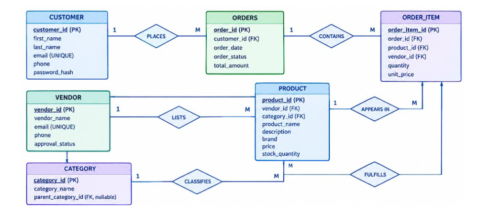

# ShopSphere — Database Architecture & Schema Documentation

## 1. System Overview
ShopSphere is a multi-vendor relational e-commerce platform built on **Next.js 14**, **Tailwind CSS**, and **Supabase (PostgreSQL RDBMS)**. The database schema strictly adheres to the core Entity-Relationship (ER) model without synthetic mock arrays or hardcoded mock data.

---

## 2. Entity-Relationship (ER) Model

The database represents six primary entities connected via relational foreign keys and cardinality constraints:

| Entity (Table) | Primary Key (PK) | Attributes | Foreign Keys (FK) | Relationships |
|---|---|---|---|---|
| **CUSTOMER** (`customers`) | `customer_id` (UUID) | `first_name`, `last_name`, `email` (UNIQUE), `phone`, `password_hash`, `created_at` | None | `1 : M` with `orders` (*PLACES*) |
| **VENDOR** (`vendors`) | `vendor_id` (UUID) | `vendor_name`, `email` (UNIQUE), `phone`, `approval_status`, `created_at` | None | `1 : M` with `products` (*LISTS*) `1 : M` with `order_items` (*FULFILLS*) |
| **CATEGORY** (`categories`) | `category_id` (UUID) | `category_name`, `parent_category_id` | `parent_category_id` → `categories(category_id)` | Self-referencing hierarchy `1 : M` with `products` (*CLASSIFIES*) |
| **PRODUCT** (`products`) | `product_id` (UUID) | `product_name`, `description`, `brand`, `price`, `stock_quantity`, `image_url`, `created_at` | `vendor_id` → `vendors(vendor_id)` `category_id` → `categories(category_id)` | `M : 1` with `vendors` (*LISTS*) `M : 1` with `categories` (*CLASSIFIES*) `1 : M` with `order_items` (*APPEARS IN*) |
| **ORDERS** (`orders`) | `order_id` (UUID) | `order_date`, `order_status`, `total_amount` | `customer_id` → `customers(customer_id)` | `M : 1` with `customers` (*PLACES*) `1 : M` with `order_items` (*CONTAINS*) |
| **ORDER_ITEM** (`order_items`) | `order_item_id` (UUID) | `quantity`, `unit_price` | `order_id` → `orders(order_id)` `product_id` → `products(product_id)` `vendor_id` → `vendors(vendor_id)` | `M : 1` with `orders` (*CONTAINS*) `M : 1` with `products` (*APPEARS IN*) `M : 1` with `vendors` (*FULFILLS*) |

---

## 3. Relational Cardinality & Integrity Constraints

1. **`customers` → `orders` (`1:M`)**:
   - A customer can place multiple orders over time.
   - Referential action: `ON DELETE RESTRICT` prevents accidental deletion of customer records associated with order history.

2. **`orders` → `order_items` (`1:M`)**:
   - Each order contains one or more line items.
   - Referential action: `ON DELETE CASCADE` ensures child line items are removed if an order record is purged.

3. **`products` → `order_items` (`1:M`)**:
   - An individual catalog item can appear across multiple order items.
   - Referential action: `ON DELETE RESTRICT` protects catalog items currently linked to orders.

4. **`vendors` → `products` (`1:M`)**:
   - Each vendor lists multiple products in the marketplace.
   - Referential action: `ON DELETE CASCADE` cascades product listings if a vendor is completely removed.

5. **`vendors` → `order_items` (`1:M`)**:
   - Directly establishes vendor fulfillment tracking per line item in a multi-vendor cart.

6. **`categories` → `categories` (`1:M` self-referential)**:
   - Supports multi-level hierarchical taxonomy (e.g., *Electronics* → *Audio & Wearables*).
   - Referential action: `ON DELETE SET NULL` ensures sub-categories become top-level if the parent is deleted.

---

## 4. DDL Definition & SQL Script Files

All database definitions and seed records are maintained in the repository:
- **`supabase/schema.sql`**: Complete PostgreSQL DDL with table creation, constraints, indexes, and Row Level Security (RLS) policies.
- **`supabase/seed.sql`**: Deterministic UUID seed dataset populating customers, vendors, multi-tier categories, products, and historic order queues.

---

## 5. ACID Transaction Execution in Atomic Checkout

When an order is submitted via the checkout interface:
1. An order record is inserted with `customer_id`, calculated `total_amount`, and status `'Placed'`.
2. All cart items are batch-inserted into `order_items` referencing `order_id`, `product_id`, and `vendor_id`.
3. Inventory counts in `products.stock_quantity` are decremented by the purchased quantities.
4. Transaction results and SQL logs are live-streamed to the UI audit terminal.
